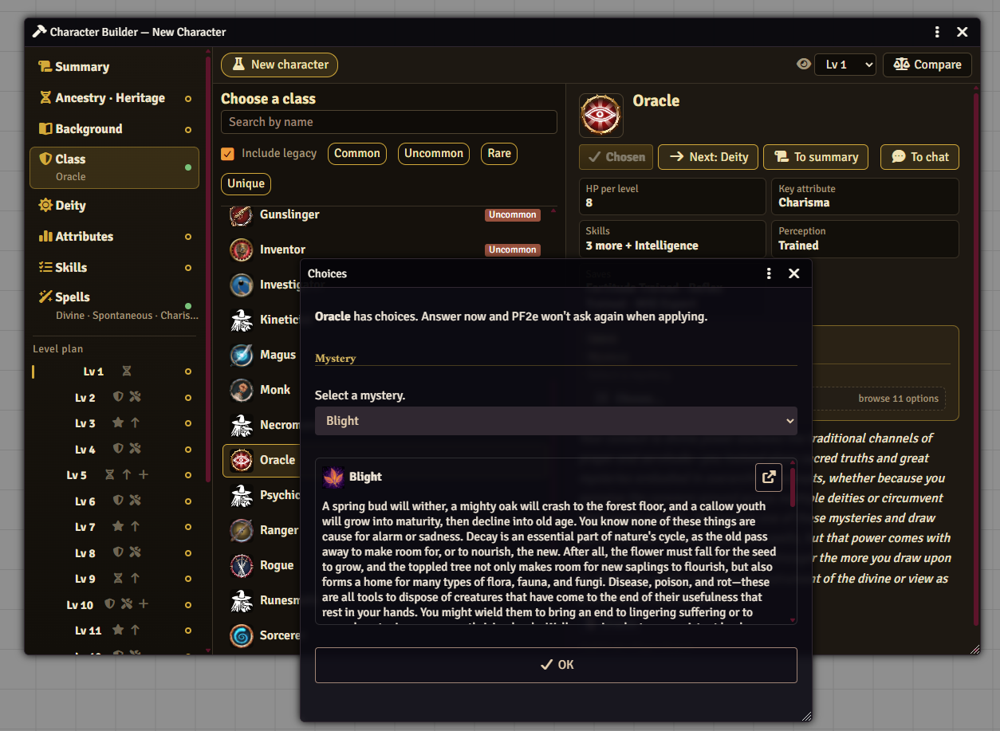
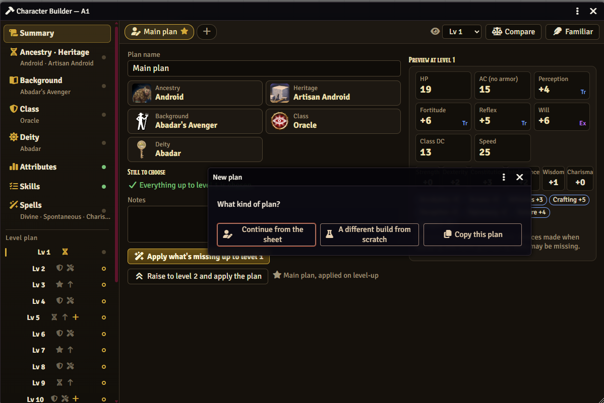
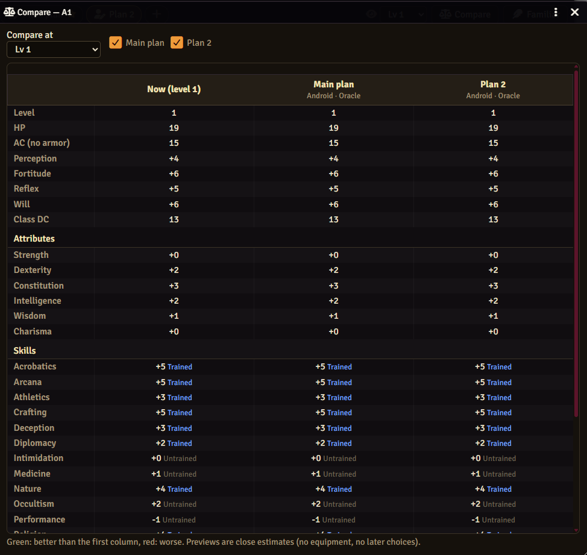

# Rutz's PF2e Character Builder

[Patreon](https://www.patreon.com/Rutz179) · [Discord](https://discord.gg/pnVW5QmXKx) · [위키](https://github.com/Rutz179/rutz-pf2e-builder/wiki/한국어-안내) · [English](README.md)

Foundry VTT용 **패스파인더 2판(PF2e)** 캐릭터 빌더이자 레벨 계획 도구입니다. 선택지마다 설명을 읽으며 캐릭터를 단계별로 만들고, **1~20레벨**을 미리 계획하고, 여러 빌드를 비교하고, 레벨업할 때 계획을 한 번에 적용합니다.



## 할 수 있는 것
- **단계별 만들기** — 선조·유산·배경·클래스·신앙·능력치·기술·주문. 목록 옆에 설명 전체가 보이고, 이름 검색·희귀도·레거시 필터, 선행 조건 ✔ / ✖ / ? 표시가 있습니다.
- **클래스 선택지를 미리** — 미스터리·뮤즈·후원자·혈통 같은 "하나 고르기"를 만드는 도중에 묻기 때문에, 적용할 때 PF2e가 다시 묻지 않습니다.
- **주문** — 클래스의 시전 방식(마법서·레퍼토리·전체 목록)을 알아서 맞추고, 레벨마다 배울 주문을 고릅니다. 집중 주문과 클래스가 주는 주문은 자동으로 들어갑니다.
- **레벨별 계획** — 레벨마다 피트(자유 아키타입 포함)·기술 상승·능력치 상승·주문. 캐릭터당 계획 여러 개(기본 5개): 지금 시트에서 이어서, 처음부터 다른 빌드, 이 계획 복제.
- **비교** — 지금 시트와 계획들을 원하는 레벨에서 나란히. 수치는 PF2e가 직접 계산합니다.
- **레벨업** — 레벨이 오르면 소유자에게 채팅 카드가 오고, 버튼 하나로 계획을 적용합니다. 적용은 더하기만 하고, 시트에 이미 있는 것은 바꾸지 않습니다.
- **사역마 빌더** — 사역마·주인 능력과 선행 조건, PF2e가 정하는 하루 능력 수.
- **GM 설정** — 플레이어당 캐릭터 수, 시작 레벨, 플레이어가 볼 희귀도, 레거시 숨기기, 읽을 컴펜디움 등.

 

## 설치
Foundry → *Add-on Modules* → *Install Module* → Manifest URL:
```
https://github.com/Rutz179/rutz-pf2e-builder/releases/latest/download/module.json
```
Foundry VTT v13–v14 · 패스파인더 2판 시스템 · 한국어 / English (Foundry 언어 설정을 따름)

한국어로 쓸 때는 Rutz의 PF2e 한글화 모듈을 함께 쓰는 것을 권합니다(이름·설명·선행 조건이 맞춰져 있음). 다른 한글화 모듈과도 동작합니다.

## 빠른 시작
1. PF2e 월드에서 모듈을 켭니다.
2. **액터** 탭 → **캐릭터 만들기** (이미 캐릭터가 있으면 버튼이 **캐릭터 빌더**로 바뀌고 그 캐릭터를 엽니다). 캐릭터 시트에서는 머리의 **빌더**.
3. 왼쪽 단계를 차례로 고릅니다. **요약**의 **남은 선택**에 빠진 것이 보이고, 다 고르면 **캐릭터 만들기**.
4. **레벨별 계획**에서 앞으로의 레벨을 정하고, **+**로 다른 계획을 만들고, **비교**로 확인합니다.
5. 레벨업하면 채팅 카드의 **계획대로 적용**을 누릅니다.

스크린샷이 있는 전체 안내: **[위키](https://github.com/Rutz179/rutz-pf2e-builder/wiki/한국어-안내)**.
매크로: `game.rutzBuilder.open(actor)`.

질문·버그 제보: [Issues](https://github.com/Rutz179/rutz-pf2e-builder/issues) 또는 [디스코드](https://discord.gg/pnVW5QmXKx).
